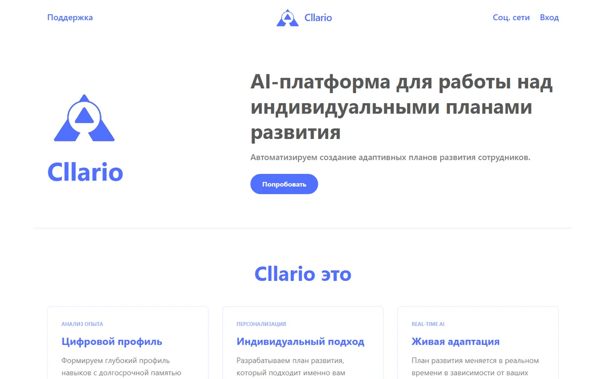

# Cllario — AI platform for personal development plans

[](https://cllario-front.vercel.app)
[](https://nextjs.org)
[](https://www.typescriptlang.org)



An employee answers a short assessment, Gemini turns the answers into an adaptive development plan,
and a manager sees the history of plans and progress. Cllario is the client half of a two-repo product;
the API lives in [cllario-back](https://github.com/Segaoneboy/cllario-back).

**Live demo:** https://cllario-front.vercel.app

## Features

- **Assessment flow** — multi-step form with `react-hook-form`, validation and progress state.
- **AI-generated plans** — the API returns a structured plan (summary, strengths, weaknesses,
  development steps); the client renders it as sections instead of raw text.
- **Authentication** — access + refresh tokens in httpOnly cookies, silent refresh, guarded routes.
- **Role-aware dashboards** — the dashboard renders a different view for employee, team lead and HR
  based on the signed-in user's role. Server-side role enforcement is on the roadmap.
- **Admin area** — company registration screen (`/admin/companies`); the backend endpoint is in progress.
- **State** — server state via TanStack Query (caching, background refetch), UI state in Zustand.
- **UX details** — skeleton loaders, toasts for errors, responsive layout from 360px.

## Stack

| Layer | Technology |
|---|---|
| Framework | Next.js 15 (App Router), React 19 |
| Language | TypeScript |
| Styling | Tailwind CSS v4, Framer Motion |
| Data | TanStack Query, Zustand, `react-hook-form` |
| Icons | Tabler Icons |
| Tests | Jest + React Testing Library |
| Analytics | Yandex Metrika |

## How the API is called

The browser never talks to the backend directly. All requests go through a Next.js route handler
(`app/api/[...path]/route.ts`) which proxies them to `BACKEND_URL` and keeps the httpOnly auth
cookies on the same origin. That avoids CORS on preflight and keeps tokens out of `localStorage`.

## Getting started

```bash
npm install
cp .env.example .env.local   # fill in the values
npm run dev                  # http://localhost:3000
```

### Environment variables

| Variable | Purpose |
|---|---|
| `BACKEND_URL` | Base URL of the Cllario API (default `http://localhost:5000`) |
| `CLLARIO_ADMIN_REGISTRATION_KEY` | Key required to register a manager account |
| `NEXT_PUBLIC_YANDEX_METRIKA` | Yandex Metrika counter ID (optional) |

## Tests

```bash
npm test
```

## Project structure

```
app/            routes, layout, API proxy
components/     UI components (forms, plan cards, layout)
store/          Zustand stores
types/          shared TypeScript types
utils/          API client and helpers
```

## Roadmap

- [ ] Plan history with diff between versions
- [ ] Export a plan to PDF
- [ ] Manager dashboard with team-level aggregates
- [ ] E2E coverage of the auth + assessment flow (Playwright)

## License

MIT
